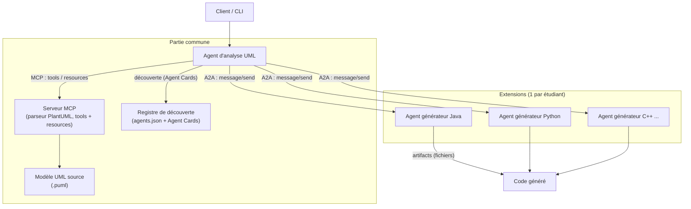
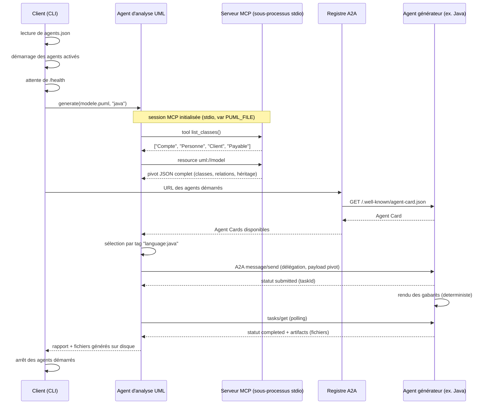
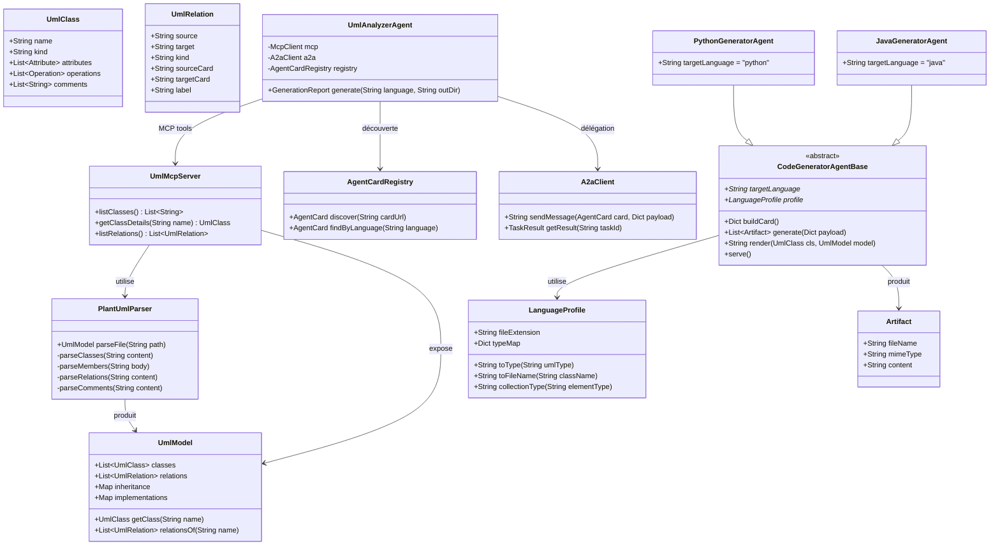
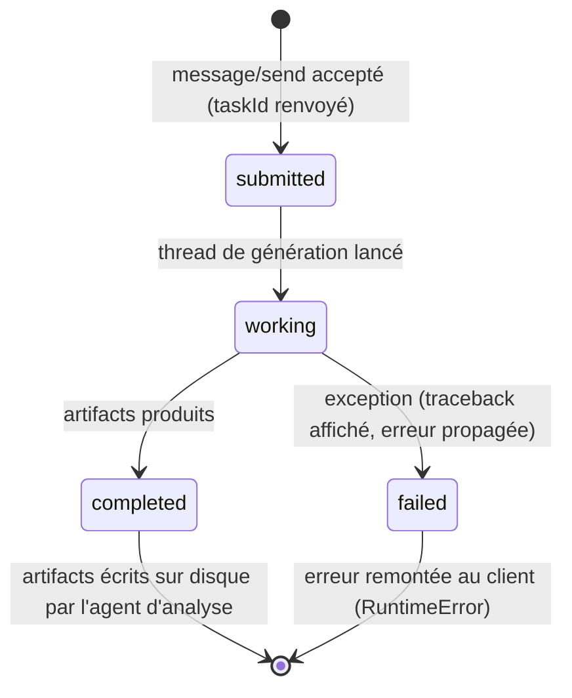

# umlFactoryCode

## Génération de code à partir de diagrammes UML par une architecture d'agents (MCP + A2A)

*Documentation réalisée dans le cadre du TP noté 2 — Génie logiciel (Python 3.10+).*

---

## Sommaire

1. [Introduction](#1-introduction)
2. [Les deux protocoles : MCP et A2A](#2-les-deux-protocoles-mcp-et-a2a)
3. [Architecture générale](#3-architecture-générale)
4. [Les composants en détail](#4-les-composants-en-détail)
5. [Scénario nominal : déroulé complet](#5-scénario-nominal--déroulé-complet)
6. [Les formats d'échange](#6-les-formats-déchange)
7. [Partie commune et extensions](#7-partie-commune-et-extensions)
8. [Guide d'installation et d'utilisation](#8-guide-dinstallation-et-dutilisation)
9. [Ajouter un nouveau langage](#9-ajouter-un-nouveau-langage)
10. [Choix techniques et limites](#10-choix-techniques-et-limites)
11. [Glossaire](#11-glossaire)

**Annexes (diagrammes)**
- [Annexe A — Diagramme de composants](#annexe-a--diagramme-de-composants)
- [Annexe B — Diagramme de séquence du scénario nominal](#annexe-b--diagramme-de-séquence-du-scénario-nominal)
- [Annexe C — Diagramme de classes](#annexe-c--diagramme-de-classes)
- [Annexe D — Cycle de vie d'une tâche A2A](#annexe-d--cycle-de-vie-dune-tâche-a2a)

---

## 1. Introduction

Le projet **umlFactoryCode** permet de générer du code (par exemple en Java ou en Python) à partir d'un diagramme de classes PlantUML (`.puml`). Au départ, j'avais un script principal, `umlfactory2Java.py`. J'ai repris son fonctionnement, mais j'ai séparé le projet en plusieurs parties pour que chaque composant ait un rôle précis. Les échanges entre les agents reposent sur deux protocoles :

- **MCP** (*Model Context Protocol*) relie chaque agent à ses outils et données ;
- **A2A** (*Agent2Agent*) fait collaborer des agents indépendants.

### Comment fonctionne le système

```text
model.puml ====> [Serveur MCP] ====> [Agent d'analyse UML] ====> [Agent générateur Java]
     PlantUML     expose le           lit le modèle, choisit      produit les fichiers
                  modèle pivot        le bon générateur           sources en artifacts
```

### Les objectifs que j'ai cherché à respecter

| Objectif | Ce que j'ai mis en place |
| --- | --- |
| Séparer les rôles | Le parseur, l'agent d'analyse et les générateurs ont chacun une fonction précise. |
| Organiser les échanges | Les agents échangent des données au format JSON et publient une Agent Card. |
| Ajouter d'autres langages | Un générateur peut être ajouté dans `generators/` sans réécrire toute la partie commune. |
| Tester facilement | La génération utilise des gabarits Jinja2. Aucun LLM ni clé d'API n'est nécessaire. |

---

## 2. Les deux protocoles : MCP et A2A

### 2.1 MCP — l'agent et ses outils

MCP permet à un agent d'accéder à des **outils** et à des **données** de façon organisée. Dans mon projet, le serveur MCP donne accès au modèle UML :

- **Tools** (fonctions appelables) : `list_classes`, `get_class_details`, `list_relations` ;
- **Resources** (données lisibles, adressées par URI) : `uml://model` (pivot complet) et `uml://class/{nom}` (une classe).

Le serveur tourne en transport **stdio** : l'agent d'analyse le lance comme sous-processus et dialogue avec lui par entrées/sorties standard.

### 2.2 A2A — les agents entre eux

A2A permet à des agents de communiquer sans avoir besoin de connaître leur fonctionnement interne. Ici, il sert à transmettre le modèle UML aux générateurs :

- **Découverte** : chaque générateur publie une **Agent Card** (JSON) sur `/.well-known/agent-card.json`, décrivant sa compétence via des *tags* (`language:java`, `language:python`) ;
- **Délégation** : `message/send` crée une **tâche asynchrone** (le résultat est *retardé*) ;
- **Résultat** : `tasks/get` interroge la tâche jusqu'à `completed` ; la réponse contient des **artifacts** (paires nom de fichier / contenu).

### 2.3 Pourquoi ils sont complémentaires

| | MCP | A2A |
| --- | --- | --- |
| Relie | agent <==> outils / données | agent <==> agent |
| Ici | analyse <==> modèle UML | analyse <==> générateurs |
| Apporte | accès standardisé aux données | découverte, délégation, asynchrone |

L'agent d'analyse n'a donc pas besoin de connaître le code de chaque générateur. Il consulte sa Agent Card pour savoir quel langage celui-ci peut traiter.

---

## 3. Architecture générale

On peut distinguer quatre grandes parties dans le projet (voir [Annexe A](#annexe-a--diagramme-de-composants)) :

1. **Serveur MCP** (`common/mcp_server`) — parse le fichier `.puml` (via `PlantUmlParser`) et expose le pivot à travers tools et resources.
2. **Agent d'analyse UML** (`common/analyzer`) — l'orchestrateur : lit le modèle via MCP, sélectionne le générateur compétent dans le registre, délègue par A2A, écrit les artifacts sur disque.
3. **Agents générateurs** (`generators/<langage>_gen`) — un par langage cible. Chacun sert sa Agent Card, reçoit des tâches A2A et rend le code avec des gabarits.
4. **Configuration et registre de découverte** (`agents.json` + `AgentCardRegistry`) — `agents.json` décrit les générateurs à démarrer (langage, module Python, port et activation). Après leur démarrage, le registre récupère leurs Agent Cards à partir des URL construites par `main.py`.

### Principes structurants

- **Pivot neutre** : le format d'échange (`UmlModel` sérialisé en JSON) ne mentionne aucun langage cible. Le fichier source `.puml` est encapsulé derrière le parseur : changer le format d'entrée ne touche qu'un seul fichier.
- **Ouvert/fermé** : la mécanique commune (A2A, tâches, rendu) est figée ; tout ce qui varie par langage (typage, nommage, conteneurs, gabarits) vit dans l'extension.
- **Déterminisme** : la génération est purement gabarit + données ; deux exécutions donnent le même résultat.

---

## 4. Les composants en détail

### 4.1 Le parseur PlantUML (`common/model/puml_parser.py`)

Il reprend fidèlement la logique de lecture du script d'origine `umlfactory2Java.py` et reconnaît :

- classes, **interfaces**, classes **abstraites** (avec corps optionnel) ;
- attributs et méthodes, avec visibilités (`+ - # ~`) et paramètres typés ;
- **héritage** (`Personne <|-- Client`) et **implémentation** (`Client ..|> Payable`) ;
- relations `-->` (directionnelle), `--` (bidirectionnelle), `o--` (agrégation), `*--` (composition), avec **cardinalités** (`1`, `1..1`, `0..1`, `0..*`), **rôles** et **libellés** ; les relations bidirectionnelles produisent un lien inverse ;
- **commentaires** : inline (`class Client "représente un client"`) et notes PlantUML (`note right of X … end note`).

Sa seule sortie est le pivot `UmlModel` — il ne sait rien de Java, Python ou de tout langage cible.

### 4.2 Le pivot `UmlModel` (`common/model/uml_model.py`)

C'est le **contrat central** de tout le système :

| Élément | Contenu | Utilisé par |
| --- | --- | --- |
| `classes` | nom, genre (`class`/`abstract`/`interface`), attributs, opérations, commentaires | serveur MCP, générateurs |
| `relations` | source, cible, type, cardinalités, rôles, libellé | générateurs (attributs de relation) |
| `inheritance` | enfant → parent | générateurs (`extends`) |
| `implementations` | classe → interfaces | générateurs (`implements`) |

Le prédicat `is_multiple(cardinalité)` traduit la règle générique « cardinalité multiple ⇒ collection » ; le choix du conteneur (`List<T>`, `list[...]`, `std::vector`) reste au profil de chaque langage.

### 4.3 Le serveur MCP (`common/mcp_server/server.py`)

| Interface | Élément | Rôle |
| --- | --- | --- |
| Tool | `list_classes()` | noms de toutes les classes/interfaces |
| Tool | `get_class_details(nom)` | genre, membres, `extends`, `implements`, relations, commentaires |
| Tool | `list_relations()` | toutes les relations (types, cardinalités, rôles, libellés) |
| Resource | `uml://model` | le pivot complet (JSON) — c'est lui qui voyage dans A2A |
| Resource | `uml://class/{nom}` | le pivot d'une seule classe |

Le fichier `.puml` à lire est passé par la variable d'environnement `PUML_FILE` lors du lancement.

### 4.4 L'agent d'analyse UML (`common/analyzer/agent.py`)

L'agent d'analyse coordonne les étapes. Il récupère d'abord le modèle UML avec MCP, cherche ensuite le générateur correspondant au langage demandé, puis lui transmet les données avec A2A. Il attend la fin de la tâche avant d'enregistrer les fichiers reçus dans le dossier de sortie. Le programme principal lit `agents.json`, démarre les agents activés, vérifie leur disponibilité et construit le registre à partir de leurs URL. Il arrête ensuite les processus qu'il a lancés, même si la génération échoue.

### 4.5 La base des générateurs (`common/a2a/generator_base.py`)

`CodeGeneratorAgentBase` porte toute la mécanique commune côté serveur A2A : publication de l'Agent Card, tâches asynchrones (`message/send` → thread de génération → `tasks/get`), gestion des erreurs (traceback affiché + champ `error` propagé au client), et rendu par gabarit (contexte précalculé : attributs typés, relations converties en attributs commentés, méthodes des interfaces à surcharger).

Ce que chaque extension définit : `target_language`, un **`LanguageProfile`** (types primitifs, nommage de fichiers, conteneur des collections) et un **gabarit Jinja2**. Le profil Java reproduit la sortie de `umlfactory2Java.py` ; le profil Python démontre la généricité du dispositif.

---

## 5. Scénario nominal : déroulé complet

Pour lancer une génération Java avec `python main.py generate models/model.puml -l java -o out_java/`, voici les principales étapes (voir aussi [Annexe B](#annexe-b--diagramme-de-séquence-du-scénario-nominal)) :

1. **Démarrage** : `main.py` lance l'agent Java et attend qu'il réponde sur sa route `/health`.
2. **Lecture du modèle** : l'agent d'analyse démarre le serveur MCP en sous-processus, appelle `list_classes`, puis récupère le pivot complet avec `uml://model`.
3. **Choix du générateur** : le registre trouve l'agent qui annonce la compétence `language:java`.
4. **Envoi de la demande** : l'agent d'analyse transmet le pivot avec `message/send`. Le générateur renvoie un identifiant de tâche.
5. **Récupération du résultat** : l'agent d'analyse interroge `tasks/get` jusqu'à la fin de la tâche.
6. **Écriture des fichiers** : les artifacts sont enregistrés dans `out_java/` et un rapport JSON récapitule les fichiers produits.
7. **Arrêt** : `main.py` arrête les agents qu'il a démarrés.

---

## 6. Les formats d'échange

### 6.1 Agent Card (publiée par chaque générateur)

```json
{
  "name": "java-codegen",
  "description": "Génère du code java à partir d'un modèle UML (pivot JSON).",
  "url": "http://127.0.0.1:8001",
  "skills": [{"id": "java-gen", "tags": ["code-generation", "language:java"]}],
  "capabilities": {"artifacts": true}
}
```

### 6.2 Payload `message/send` (délégation)

```json
{
  "jsonrpc": "2.0", "id": 1,
  "method": "message/send",
  "params": {
    "action": "generate",
    "model": {
      "classes": [
        {"name": "Client", "kind": "class",
         "attributes": [{"name": "email", "type": "String", "visibility": "private"}],
         "operations": [],
         "comments": ["represente un client"]}
      ],
      "relations": [
        {"source": "Client", "target": "Compte", "kind": "composition",
         "target_card": "0..*", "label": "possede"}
      ],
      "inheritance": {"Client": "Personne"},
      "implementations": {"Client": ["Payable"]}
    }
  }
}
```

### 6.3 Réponse `tasks/get` (résultat retardé)

```json
{
  "status": "completed",
  "artifacts": [
    {"fileName": "Client.java",
     "content": "import java.util.ArrayList;\n..."}
  ],
  "error": null
}
```

En cas d'échec (`"status": "failed"`), le champ `error` porte l'exception du générateur et le traceback complet est affiché dans son terminal.

---

## 7. Partie commune et extensions

```text
umlFactoryCode/
├── common/                  <= PARTIE COMMUNE
│   ├── model/               uml_model.py (pivot), puml_parser.py (lecture .puml)
│   ├── mcp_server/           server.py (tools + resources)
│   ├── a2a/                  card.py, registry.py, client.py, generator_base.py
│   └── analyzer/             agent.py (orchestration)
├── generators/              <= EXTENSIONS
│   ├── java_gen/            agent.py + templates/class.java.j2
│   ├── python_gen/          agent.py + templates/class.py.j2
│   └── cpp_gen/             agent.py + templates/class.hpp.j2 + class.cpp.j2
├── models/model.puml        Modèle
├── main.py                  CLI d'orchestration générique
├── agents.json              configuration des générateurs (langage, module, port, activation)
└── readme.md                Livrable 
```

**Le contrat entre les deux** tient en trois points, à figer tôt :[le pivot JSON](#6.2), [la Agent Card](#6.1), les [artifacts](#6.3). Une fois ce contrat posé, il est possible de développer des générateurs **en parallèle**, sans qu'on ai la moindre dépendance entre les générateurs.

---

## 8. Guide d'installation et d'utilisation

### Prérequis

- Python 3.10 ou supérieur (testé 3.12) ;
- `pip install -r requirements.txt` → `mcp`, `fastapi`, `uvicorn`, `httpx`, `jinja2`.

### Lancement depuis un seul terminal

Depuis la racine du projet, je lance directement `main.py`. Celui-ci lit `agents.json`, démarre les agents activés, attend que chacun soit prêt, effectue la génération puis arrête les processus qu'il a lancés.

```bash
# Génération en Java
python main.py generate models/model.puml -l java -o out_java/

# Génération en Python
python main.py generate models/model.puml -l python -o out_python/

# Génération en C++ (si l'agent C++ est présent et activé)
python main.py generate models/model.puml -l cpp -o out_cpp/
```

On peut aussi préciser l'hôte, le fichier de configuration des agents ou le délai maximal d'attente au démarrage :

```bash
python main.py generate models/model.puml -l java -o out_java/ --host 127.0.0.1 --agents agents.json --startup-timeout 30
```

Les ports sont définis dans `agents.json` : je n'ai donc plus besoin d'ajouter une option `--java-port`, `--python-port` ou `--cpp-port` à chaque nouveau langage.

Le serveur MCP est lancé automatiquement par l'agent d'analyse. Les agents générateurs sont également démarrés par la commande principale : toute l'exécution se fait donc depuis le même terminal.

### Configuration des agents (`agents.json`)

Le fichier `agents.json` contient une entrée par générateur. Voici la structure utilisée :

```json
[
  {
    "language": "java",
    "module": "generators.java_gen.agent",
    "port": 8001,
    "enabled": true
  }
]
```

- `language` : nom utilisé avec `-l` et annoncé dans l'Agent Card ;
- `module` : chemin du module Python lancé avec `python -m` ;
- `port` : port HTTP propre à l'agent ;
- `enabled` : permet d'activer ou de désactiver l'agent (facultatif, `true` par défaut).

L'orchestrateur vérifie notamment que le module, le langage et le port sont renseignés, que les langages et ports ne sont pas en double et qu'au moins un agent est activé. Il accepte également une configuration enveloppée dans un objet JSON contenant une clé `agents`.

### Vérifier le fonctionnement

```bash
# Carte d'un générateur (dans un navigateur ou via curl)
curl http://127.0.0.1:8001/.well-known/agent-card.json
```

### Modèle de test

`models/model.puml` couvre délibérément toutes les constructions : classe, classe abstraite, interface, héritage, implémentation, composition avec cardinalité `0..*`, commentaire inline et note attachée. La sortie attendue — par ex. `Client.java` avec `extends Personne implements Payable` et `private List<Compte> compteList = new ArrayList<>();` — sert d'oracle pour les tests.

### En cas d'erreur « génération échouée »

Le champ `error` de la réponse contient le message d'erreur renvoyé par le générateur. Le détail de l'exception s'affiche aussi dans le terminal. Il faut notamment vérifier les noms et l'emplacement des gabarits dans `templates/` ainsi que leur encodage UTF-8. Si l'agent ne démarre pas, vérifier également que le port choisi n'est pas déjà utilisé et que les dépendances sont installées.

---

## 9. Ajouter un nouveau langage

L'ajout d'un langage ne nécessite plus de modifier `main.py`. Je dois créer le générateur, puis l'enregistrer dans le fichier de configuration.

1. **Créer le module du générateur**, par exemple `generators/rust_gen/`, avec :
   - un agent qui hérite de `CodeGeneratorAgentBase` ;
   - un `LanguageProfile` décrivant les types, les conventions de nommage et les collections ;
   - les gabarits Jinja2 nécessaires dans `templates/` ;
   - un point d'entrée exécutable avec `python -m generators.rust_gen.agent` ;
   - les routes attendues par l'orchestrateur, notamment `/health` et `/.well-known/agent-card.json`.
2. **Ajouter une entrée dans `agents.json`** :

```json
{
  "language": "rust",
  "module": "generators.rust_gen.agent",
  "port": 8004,
  "enabled": true
}
```

3. **Lancer la génération** :

```bash
python main.py generate models/model.puml -l rust -o out_rust/
```

`main.py` lit automatiquement la configuration. Il démarre tous les agents activés, vérifie leur disponibilité sur `/health`, puis transmet au registre les URL des agents démarrés. Le registre consulte leurs Agent Cards et l'agent d'analyse sélectionne celui qui annonce le tag `language:rust`.

Pour désactiver temporairement un générateur, je peux mettre `"enabled": false`. Chaque langage doit avoir un module Python, un port et une compétence (`language:<nom>`) cohérents. Le port doit être libre. L'orchestrateur suppose également que chaque agent accepte les arguments `--host` et `--port`.

Ainsi, l'ajout d'un langage consiste à ajouter son extension et sa configuration : je n'ai pas à ajouter de condition ni de nouvel argument spécifique dans `main.py`.

---

## 10. Choix techniques et limites

| Choix | Motivation | Limite assumée |
| --- | --- | --- |
| MCP en stdio (sous-processus) | Zéro infra, zéro clé, conforme au SDK officiel | Pas de serveur MCP partagé entre plusieurs clients distants |
| A2A « maison » (JSON-RPC subset) | Lisible, pédagogique, fidèle à l'esprit du protocole (Card, tâches, artifacts) | Pas d'authentification mutuelle ni de push/webhooks — piste d'évolution vers `a2a-sdk` |
| Parseur regex | Simple, reprend la logique du script d'origine | Couvre le sous-ête usuel de PlantUML ; s'il manque une syntaxe, seul `puml_parser.py` est à étendre |
| Agents déterministes (gabarits) | Testable sans clé, reproductible | Pas de « compréhension » du modèle ; un LLM pourrait être ajouté en option côté analyse |
| Thread de génération | Démontre le résultat retardé des tâches A2A | Suffisant à l'échelle du TP ; pas de file persistante |

### Quelques points de vigilance

Les outils MCP utilisés dans ce projet servent à lire le modèle. Il faut tout de même vérifier les données provenant des fichiers `.puml`, car des noms ou des contenus mal formés peuvent produire du code incorrect. Pour une utilisation en production, il faudrait aussi renforcer la sécurité des échanges entre agents avec HTTPS et une authentification, puis conserver un journal des tâches exécutées.

---

## 11. Glossaire

| Terme | Définition |
| --- | --- |
| **Pivot** | Format neutre (`UmlModel`) dans lequel vit le modèle UML ; unique langue commune de tous les composants |
| **Agent Card** | Fichier JSON publié par un agent A2A décrivant ses compétences (skills, tags) |
| **Artifact** | Résultat d'une tâche A2A : ici, un fichier source (nom + contenu) |
| **Tool / Resource** | Fonction appelable / donnée lisible, exposées par un serveur MCP |
| **Cardinalité** | Multiplicité d'une relation (`1`, `0..1`, `0..*`…) ; multiple ⇒ collection dans le code généré |
| **Rôle** | Nom donné à l'extrémité d'une relation (fournit le nom de l'attribut généré) |
| **Profil de langage** | Classe portant les conventions d'un langage cible (types, nommage, conteneurs) |
| **Gabarit** | Template Jinja2 produisant le code d'une classe à partir du pivot |

---
---

# ANNEXES — Diagrammes

## Annexe A — Diagramme de composants

Ce diagramme donne une vue d'ensemble du projet. La partie commune regroupe le modèle, le serveur MCP, l'agent d'analyse et le registre. Les générateurs Java, Python, C++ ou d'autres langages sont des extensions configurées dans `agents.json`. MCP permet d'accéder aux données UML et A2A transmet le travail aux générateurs.



## Annexe B — Diagramme de séquence du scénario nominal

Le diagramme représente les échanges pendant une génération : l'orchestrateur lit la configuration, démarre les agents activés et attend leur disponibilité. L'agent d'analyse récupère ensuite le modèle avec MCP, choisit le générateur avec A2A et récupère les fichiers produits.



## Annexe C — Diagramme de classes

Conception objet : la partie commune (pivot, parseur, serveur MCP, orchestrateur, couche A2A) et la hiérarchie des générateurs. La clé de l'extensibilité : `PythonGeneratorAgent` et `JavaGeneratorAgent` n'ajoutent que `target_language`, un profil et des gabarits — toute la mécanique est héritée de `CodeGeneratorAgentBase`.



## Annexe D — Cycle de vie d'une tâche A2A

Le résultat d'une délégation est **retardé** : le générateur répond immédiatement `submitted`, travaille en arrière-plan, et l'agent d'analyse interroge la tâche jusqu'à un état terminal.



---

